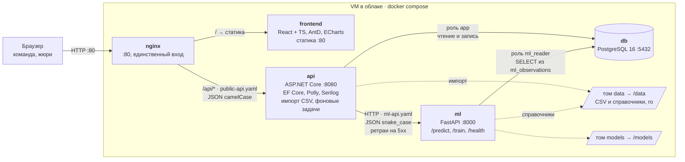
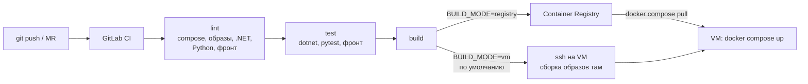

# Архитектура решения

Пять контейнеров на одной VM в облаке, поднимаются через `make up` (`infra/docker-compose.yml`). Снаружи открыт только nginx. C#-бэкенд владеет публичным API и данными, ML-сервис только считает прогноз и закрыт за API.

## Сервисы

- Фронт ходит только в C# API (через nginx), про ML не знает. ML можно заменить, не трогая фронт.
- `ml` и `db` наружу не публикуются.
- Заголовок `X-Correlation-Id` идёт сквозь цепочку фронт → API → ML.
- Если ML недоступен, `/api/health` отвечает `Degraded` с кодом 200. Без БД API не готов.

## Сборка и деплой

Если внешние реестры закрыты, на VM запускают `OFFLINE=1`: образы и пакеты берутся из заранее выгруженного запаса (`infra/scripts/offline-pack.sh` / `offline-load.sh`).

Контракты и переменные: [`contracts/CONVENTIONS.md`](contracts/CONVENTIONS.md).
